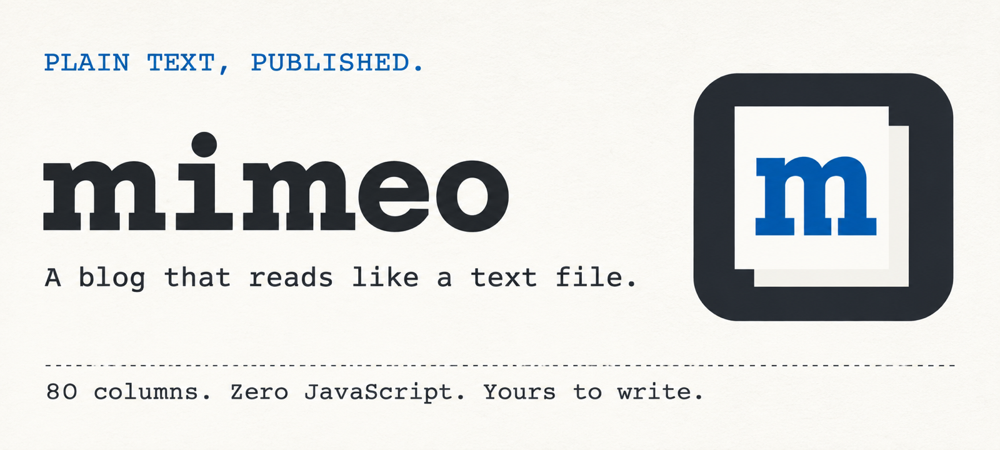
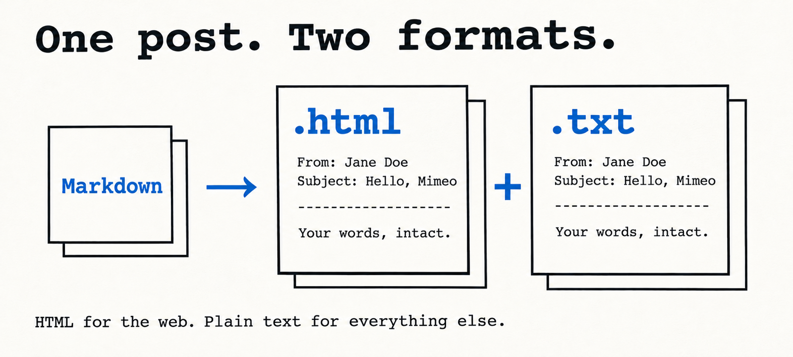

# Mimeo



[Live demo](https://haydenk.github.io/hugo-mimeo/)

A Hugo theme that renders a blog the way a `.patch` file or a mailing-list
archive reads: a message header, then the body, in a monospaced column that
never grows past eighty characters. It is still HTML, because links and
images are worth having, but nothing else was kept. No JavaScript, no
webfonts, no icons, no toggle: light and dark follow the system preference
through CSS `light-dark()`.

Named after the mimeograph, which ran off plain monospaced copies of typed
pages.

```text
From:          Hayden King
Date:          Sat, 31 Oct 2026 17:30:00 +0000
Subject:       [bible-notes] Serving the Body of Christ
Tags:          stewardship, generosity
Series:        built-different
X-Plain-Text:  /bible-notes/2026/10/31/serving-the-body-of-christ.txt
- - - - - - - - - - - - - - - - - - - - - - - - - - - - - - - - - - - - - -

## Scripture References

* 1 Corinthians 12:1-27
```

## What you get

* A `From:` / `Date:` / `Subject:` header block on every single page, built
  from frontmatter. The subject carries the page's `<h1>`.
* Content that looks like its Markdown source: `##` markers on headings,
  `*` on bullets, `>` on quotes, a `--` signature line in the footer.
* Code in GitHub's light and dark palettes, generated by
  `hugo gen chromastyles` and switched with CSS `light-dark()`.
* A plain-text twin of every page: add `.txt` to a page URL
  (`/posts/2026/01/02/slug.txt`) and you get the same header followed by
  the raw Markdown. Advertised with `<link rel="alternate" type="text/plain">`.
* Lists that read like a log: `2026-10-31 Title [section]`, with an
  optional one-line summary under each.
* Tags and series taxonomies, archive page grouped by month, RSS, sitemap,
  Open Graph tags, a meta description from the first paragraphs.
* JetBrains Mono when the visitor has it installed, otherwise the system
  monospace stack. Nothing is downloaded.
* Zero scripts, so a Content Security Policy needs no inline hash. The
  stylesheet is inlined by default (`style-src 'unsafe-inline'`), or set
  `params.inlineCSS = false` to link it fingerprinted instead.

## Install

Releases are tagged `vMAJOR.MINOR.PATCH`; see the
[releases page](https://github.com/haydenk/hugo-mimeo/releases). Three ways in:

**As a Hugo module** (recommended). Import it, then pin a version:

```toml
[module]
  [[module.imports]]
    path = "github.com/haydenk/hugo-mimeo"
```

```sh
hugo mod get github.com/haydenk/hugo-mimeo@v1.2.0
```

**From a release archive.** Each release ships `mimeo-<version>.tar.gz`
and `.zip`, both unpacking to a `mimeo/` directory. Extract into `themes/`
and set `theme = 'mimeo'`:

```sh
curl -fsSL https://github.com/haydenk/hugo-mimeo/releases/download/v1.2.0/mimeo-1.2.0.tar.gz \
  | tar -xz -C themes
```

**With mise**, if the blog pins its tools that way: a file task that
installs the pinned version and is a no-op when it is already there. Save
it as `.mise/tasks/theme`, `chmod +x` it, and run `mise run theme` (or make
`build` depend on it):

```sh
#!/usr/bin/env bash
#MISE description="Install the pinned Mimeo theme into themes/mimeo"
set -euo pipefail
version="1.2.0"
if [ "$(cat themes/mimeo/VERSION 2>/dev/null)" = "$version" ]; then exit 0; fi
rm -rf themes/mimeo && mkdir -p themes
curl -fsSL "https://github.com/haydenk/hugo-mimeo/releases/download/v$version/mimeo-$version.tar.gz" \
  | tar -xz -C themes
```

Each archive carries a `VERSION` file for exactly this check.

Then add these lines to the site's own config. By default Hugo does not
merge a theme's `[outputs]` or `[markup]` into a site, so without them no
`.txt` files are written, code blocks get Chroma's inline styles instead of
the theme's light/dark colours, and captioned images do not become
`<figure>`:

```toml
[outputs]
  home = ['html', 'rss']
  page = ['html', 'txt']
  section = ['html']          # one feed for the site, none per section
  taxonomy = ['html']
  term = ['html']

[markup]
  [markup.highlight]
    noClasses = false
  [markup.goldmark.parser]
    wrapStandAloneImageWithinParagraph = false
```

The same blocks live in the theme's `hugo.toml`, so a site that would
rather inherit them can set `_merge = 'shallow'` under its own `[outputs]`
and `[markup]` instead of copying the lines. Per-section feeds are a
choice, not a requirement: put `'rss'` back in `section` to have them.

Hugo 0.158 or newer, standard edition (no Sass).

## Configure

Everything is optional. These are the knobs, with the values the demo uses:

```toml
[params]
  authorName = 'Jane Doe'          # From: line; a page's `author` param wins
  description = '...'              # meta description fallback
  images = ['images/og.png']       # relative to baseURL, including its subpath
  imageAlt = 'Description of the share image'
  homeIntroContent = '...'         # Markdown above the home page listing
  homeCollection = ['posts']       # section(s) listed on the home page
  homeCollectionTitle = 'Latest'
  homeCount = 10
  listSummaries = true             # one-line summary under each entry
  listDateFormat = '2006-01-02'    # Go layout
  readTime = true                  # X-Read-Time: header line
  showTags = true                  # Tags: header line
  footerContent = ''               # Markdown under the "-- " line
  inlineCSS = true

  [[params.social]]                # signature lines: "github  https://..."
    name = 'github'
    title = 'GitHub'
    url = 'https://github.com/you'
    rel = 'me'

[menus]
  [[menus.main]]
    name = 'posts'
    pageRef = '/posts'
    weight = 10

[taxonomies]
  tag = 'tags'
  series = 'series'
```

The `[outputs]` and `[markup]` lines from the Install section are required
as well; a site that already has an `[outputs]` block must keep `'txt'` in
its `page` list.

A section page can set `showListDate = false` in its frontmatter to hide
dates in its listing. A page with `type = 'archive'` renders every page on
the site grouped by month, with undated pages in their own list; give it
`outputs = ['html']` so it does not get a plain-text twin of nothing. Set `capitalizeListTitles = false` in the site
config if you want tag names left lowercase, as they are in the source.

## Customize

Prefer hooks and a custom stylesheet over overriding templates.

**Hooks.** A hook is a partial the theme calls if the site provides it:
`layouts/_partials/hooks/<name>.html`, which receives the page.

| Hook | Where it renders |
| --- | --- |
| `head-start` | First thing in `<head>`, after charset and viewport |
| `head-end` | Last thing in `<head>` |
| `single-after-content` | On single pages, inside `<article>`, after the content |
| `footer-start` | First thing in `<footer>` |
| `body-end` | Last thing in `<body>` |

**CSS.** `assets/css/custom.css` is appended to the theme stylesheet. Useful
variables on `:root`: `--font-mono`, `--width` (default `80ch`), `--bg`,
`--bg-2`, `--fg`, `--muted`, `--rule`, `--link`. Use `light-dark()` pairs
so both modes stay covered.

Code colours come from `assets/css/chroma.css`, which `mise run gen:chroma`
writes from Hugo's `github` and `github-dark` Chroma styles as
`light-dark()` pairs. The theme keeps the code block's surface, gutter and
weight itself, so only token colours come from GitHub. For other palettes,
change the two `--style` names in `.mise/tasks/gen/chroma` and rerun it, or
override the `.chroma` classes in `custom.css`.

To self-host JetBrains Mono instead of relying on an installed copy, put the
woff2 under `static/fonts/` and add an `@font-face` for the family name
`"JetBrains Mono"` to `custom.css`; the stack already lists it first.

**Images.** Reference images without a leading slash (``
for `assets/images/x.png`, or `` for a file beside `index.md`
in a page bundle). The render hook then emits width and height, serves
WebP, and resizes anything wider than 800px. A standalone image with a title
becomes a captioned `<figure>`.

**Favicon.** The theme ships a paper-stack Mimeo icon in `static/`: a
multi-resolution `favicon.ico` (16, 32, 48 and 256px), PNG favicons at
16, 32, 48 and 96px, a 180px `apple-touch-icon.png`, and `icon-192.png`
and `icon-512.png`. All are included in the built site and linked from
every page, including sites deployed under a subpath. Add files with the
same names to your site's `static/` directory to replace them, or override
`layouts/_partials/head/favicon.html` for a different icon set. The source
image is `assets/brand/mimeo-icon.png`.

**Social images.** Set `params.images` to a path relative to the site's
`baseURL` (without a leading slash) and `params.imageAlt` to its description.
A page's `images` and `imageAlt` override the site defaults. The demo uses
`exampleSite/static/images/mimeo-demo-og.png` (1200 × 630), with Open Graph
and large Twitter card metadata. The repository's separate social preview
is [`images/brand/github-social.png`](images/brand/github-social.png)
(1280 × 640), ready to upload in the repository's **Settings → General →
Social preview**. Artwork details and generation prompts are in
[`images/brand/README.md`](images/brand/README.md).

## Plain-text output



`layouts/page.txt` writes the `.txt` copy. It emits the raw Markdown as
written, so shortcodes appear verbatim there. That is deliberate: the text
file is the source, not a second rendering. If you want shortcodes expanded
in the text copy, override `page.txt` in the site.

## Develop

Tool versions are pinned in `.mise.toml` and every task is a script under
`.mise/tasks/` (`mise tasks` lists them):

```sh
mise run setup          # install the pinned tools
mise run serve          # exampleSite on http://localhost:1313
mise run test           # build exampleSite, check links and theme invariants
mise run lint:all       # rumdl, taplo, shellcheck
mise run format:check   # TOML formatting drift (format:run fixes it)
mise run gen:chroma     # regenerate assets/css/chroma.css (after a Hugo bump)
mise run ci             # everything CI runs
mise run package 1.2.0  # build the release archives into dist/
mise run labels:sync    # push .github/labels.json to the GitHub repository
mise run repo:sync      # push theme.toml's description, demo URL and tags to it
```

`test` builds with `--panicOnWarning`, checks internal links offline with
lychee, and asserts the theme's invariants: no `<script>` in any page, an
`alt` on every image, no backslash escapes inside tags, an `X-Plain-Text`
line on every single page with its `.txt` on disk, Chroma classes and a
`<figure>` somewhere in the demo (so the three required config lines are
in force), a WebP from the demo PNG, and the demo's hook partial rendered.
`chroma.css` is not checked against Hugo on every run; rerun `gen:chroma`
after bumping the Hugo pin, or `gen:chroma --check` to see if it changed.

### Branches, releases and the demo

Development is trunk-based on `master`: branch, open a pull request, merge.
`.github/workflows/ci.yml` runs `mise run ci` on every pull request and on
every push to `master`. Pull requests get `area:` labels from the paths
they touch (`.github/labeler.yml`); the label set itself lives in
`.github/labels.json` and `mise run labels:sync` (or the Sync labels
workflow, on push) creates or updates it on GitHub.

To release, cut a branch from `master` named for the version and push it:

```sh
git switch -c release/1.2.0 master && git push -u origin release/1.2.0
```

`.github/workflows/release.yml` then runs the full CI against that commit,
runs `mise run package`, tags the commit `v1.2.0`, publishes a GitHub
Release with the archives, checksums and generated notes, and builds the
example site for its GitHub Pages URL and deploys it there. That deploy is
the demo at <https://haydenk.github.io/hugo-mimeo/>; it only moves on a
release. A fix after a release is a new `release/1.2.1` branch, not a
second push to the old one. One-time setup on GitHub after creating the
repository: `mise run repo:sync` (description, homepage and topics from
`theme.toml`), `mise run labels:sync`, and Settings > Pages > Source:
GitHub Actions. Dependabot opens weekly pull requests for the SHA-pinned
actions.

## License

AGPL-3.0. See [LICENSE](LICENSE).
