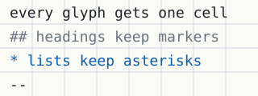
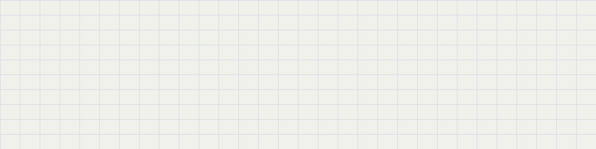

+++
title = 'Hello, Mimeo'
slug = 'hello-mimeo'
date = 2026-11-15 16:00:00
tags = ['hugo', 'themes']
series = 'building-mimeo'
+++

## What this is

Mimeo renders a Hugo site the way a `.patch` file or a mailing-list archive
looks: a header block, then the body, in a monospaced column that never
grows past eighty characters. It is still HTML, because links and images are
worth having, but nothing else was kept.

<!--more-->

## What you get

* A `From:` / `Date:` / `Subject:` header on every page, generated from
  frontmatter.
* Headings that keep their `##` markers, lists that keep their asterisks.
* Light and dark from the system preference, with CSS `light-dark()` and no
  JavaScript at all.
* A plain-text twin of every page at the same URL with `.txt` on the end:
  [this one](../hello-mimeo.txt).

Some inline code: `hugo server -D`. Some **bold** and some *emphasis*.

> A blockquote reads like a quoted reply. It can run to several lines and
> the gutter stays with it the whole way down.

## A code block

```go
package main

import "fmt"

func main() {
 fmt.Println("mimeo") // monospaced all the way down
}
```

The colours are GitHub's light and dark palettes, generated by Hugo and
switched with `light-dark()`. Without line numbers, the Hugo default:

```sh {linenos=false}
hugo server -D   # drafts too
```

## A table

| Key      | Value                       |
| -------- | --------------------------- |
| Font     | JetBrains Mono, else system |
| Width    | 80 columns                  |
| Scripts  | none                        |

## An image



A raster image wider than the column is resized to it and served as WebP.
Its alt text has a \ in it on purpose, and the small inline one that
follows ) carries a
title with quotes, to show that both survive the trip into an attribute:



1. Ordered lists keep their numbers.
2. Nested lists indent two columns.
   * like this
   * and this
